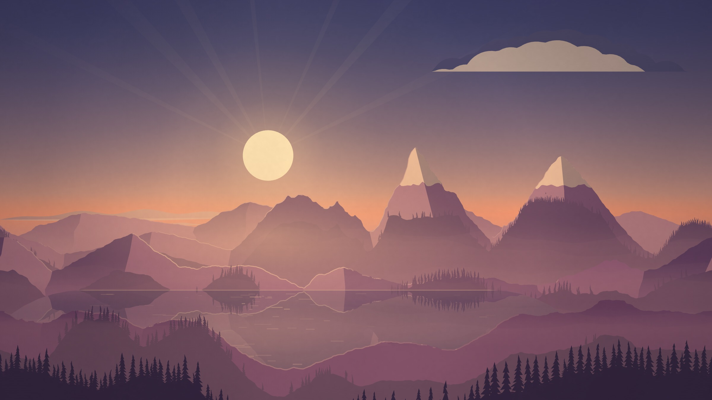

# Procedural Landscapes

Generative landscape art in the browser. Try it at [landscapes.imloul.com](https://landscapes.imloul.com).

Every landscape comes from a seed. Same seed, same picture, so when you find one you like you can send the link and the other person sees exactly what you saw. The image above is seed `c3` in the Alpine theme at dusk ([open it](https://landscapes.imloul.com/#theme=alpine&v=1&seed=c3&aspect=16%3A9&mood=dusk)).

The style borrows from Firewatch and Alto's Odyssey: flat layered silhouettes, fog between the ridges, one low sun, and slightly uneven hand-drawn edges on a paper texture.

## Using it

Press "New seed" (or space) until something catches your eye, or click one of the suggestions under the picture. From the panel on the right you can:

- switch between the two themes, Alpine Forest and Desert Dunes
- pick a mood (dawn, golden hour, midday, dusk, night or overcast) and an aspect ratio
- let the camera pan, or run a full day from sunrise to night
- open Parameters to adjust things like fog, snow or how dense the forest is
- save a PNG (up to 4K), an SVG or a looping video

The button above the picture hides the panel when you just want to watch. "Copy link" saves the exact scene, including anything you changed.

On a keyboard: space for a new seed, ← and → to go back and forth through seeds, M, A and T to change mood, aspect and theme, P to pause and F to hide the panel. The ? button lists them too.

## Development

See [docs/DEVELOPMENT.md](docs/DEVELOPMENT.md) to run it locally, add a theme or find out how the generator works.

## License

[MIT](LICENSE)
